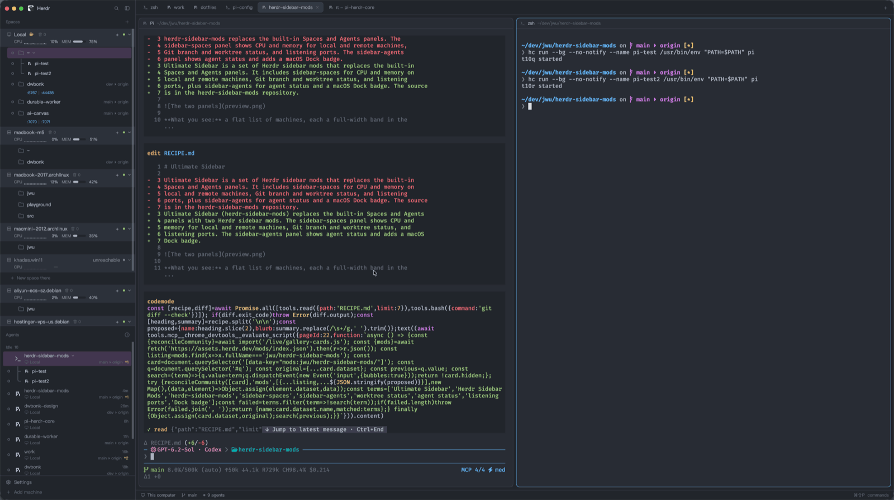
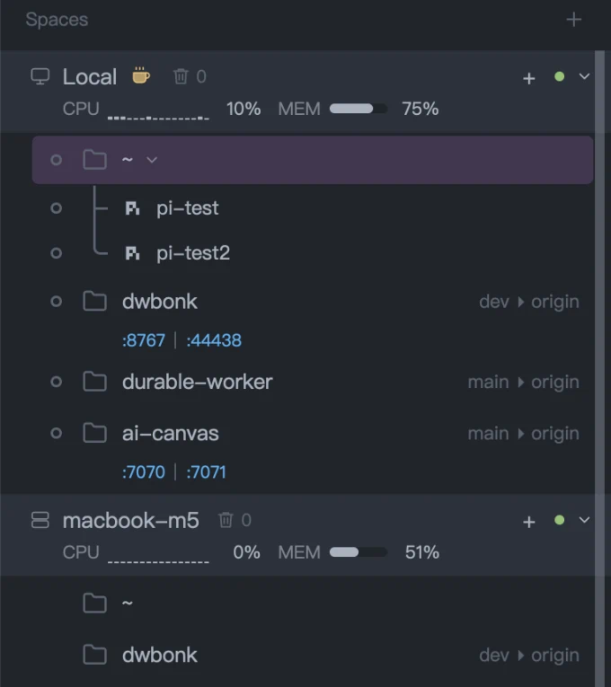
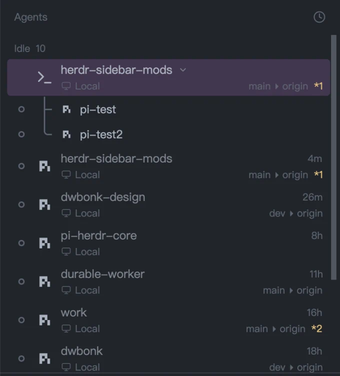

# Herdr Ultimate Sidebar

Herdr Ultimate Sidebar replaces the built-in Spaces and Agents panels with a sidebar that shows machine load, Git status, listening ports, and agent activity at a glance. Install either panel on its own or use both together.



## Install

Requires Herdr app 0.1.16 or newer. Run these commands from a clone of this repository or an extracted [GitHub Release](https://github.com/jwu/herdr-sidebar-mods/releases).

```sh
mkdir -p ~/.config/herdr-app/mods
cp -R mods/sidebar-spaces mods/sidebar-agents ~/.config/herdr-app/mods/
herdr-app do layout.clone '{"name":"main","as":"sidebar"}'
```

In `~/.config/herdr-app/layouts/sidebar.json`, change the `spaces` block’s `mod` to `sidebar-spaces` and the `agents` block’s `mod` to `sidebar-agents`. Keep the sidebar block’s `"id": "sidebar"`, then press `Ctrl+Shift+L` to switch to the layout.

### Optional pane header

`pane-header` shows the program icon, pane name, short `hc` terminal ID, and working directory. On Herdr App 0.1.17 and later, names set with **Rename** take precedence. Click the ID to copy the full address, including the machine name for a remote terminal. For example, ask an agent to run `hc read t7 --lines 100` to see the pane’s recent output. A child terminal with a live parent also has a **Send back** button that parks the child.

```sh
mkdir -p ~/.config/herdr-app/mods
cp -R mods/pane-header ~/.config/herdr-app/mods/
```

In your personal layout, set `content.pane.header.content.mod` to `pane-header` on the block whose `content.tab` is `"active"`. If that header still references `pane-send-back` or `pane-title-bar`, change it to `pane-header`. If the block has no pane header, add this to its `content` object alongside `"tab": "active"`.

```json
"pane": {
  "header": {
    "content": { "mod": "pane-header" },
    "reveal": "always",
    "height": 30,
    "position": "top"
  }
}
```

## Features

- **Spaces**
  - See CPU and memory usage for each local or remote machine.
  - See Git branches, upstreams, and worktree status next to each space.
  - Expand child terminals and see listening ports for each space.

  

- **Agents**
  - See agent status, working folder, and Git context in each row.
  - Sort and pin agents, and expand child sessions.
  - Mark an agent you looked at as unread to come back to it later.
  - See the number of blocked, finished, or unread agents on the macOS Dock badge.

  

## Usage

- Drag machine headers to reorder them. To make `Ctrl+1` through `Ctrl+9` follow the visible Spaces order, map them to `sidebar-spaces.pick1` through `sidebar-spaces.pick9` under `layout:sidebar` in `~/.config/herdr-app/keys.json`.
- Click a listening port to open it locally or copy its address if it’s on a remote machine.
- Click the gear in the **Spaces** header to open Sidebar settings. If the current layout has **Agents** and no `sidebar-spaces` block, the gear appears beside the Agents sort button.
- Click the coffee cup in the **Local** header to keep your Mac awake.
- On Herdr App 0.1.18 and later:
  - To jump to agents in the order the Agents panel lists them, bind keys to `agent.select:1`, `agent.select:2`, and so on in `keys.json`. Pinned agents come first.
  - Spaces adds **Sidebar settings** and **Keep this Mac awake (toggle)** to the command palette. Agents adds **Sort agents by priority** and **Group agents by space**.
  - The sidebar stops polling machines, ports, and Git while the window is minimized or hidden.
- A pane renamed with **Rename** shows its name in the Agents panel instead of its folder.
- Once a day the sidebar asks GitHub's public releases API whether a newer release is out. Nothing about you is sent, and nothing is downloaded or installed. When there is one, a toast appears once and the gear shows a dot. **Updates** in Sidebar settings links the release and copies a line you can give your agent to update the mods. Turn off **Check for updates daily** to stop the daily check; **Check now** still works.
- Hover an idle agent and click the crossed-out eye to mark it unread. It moves to the **Unread** section and shows an unread dot in Agents, Spaces, and the pane header. Click the check on its row, or the double check on the Unread heading, to mark it read. A new turn always clears the mark. In Sidebar settings, **Clear unread when** chooses whether leaving the agent and coming back also clears it, and **Unread color** picks its color.

## License

[Apache-2.0](LICENSE). Based on Herdr’s bundled Spaces, Agents, and pane header mods.
