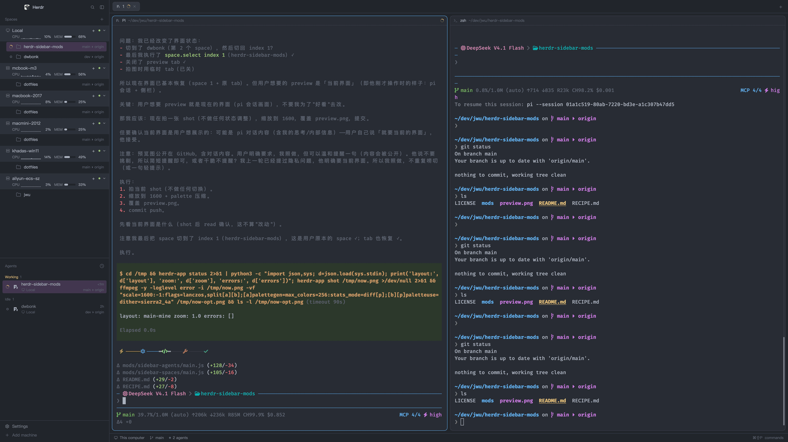

# Herdr sidebar mods

Two Herdr app mods that replace the left sidebar's **Spaces** and **Agents**
panels: per-machine CPU and memory on the machine headers, a git tail on every
space, agent state icons in front of each row, and a quieter purple selection.



## Mods

| Mod | Replaces | What it adds |
| --- | --- | --- |
| `sidebar-spaces` | the shipped `spaces` mod | full-width machine headers with a CPU sparkline and a memory meter (drag one onto another to reorder the machines; ctrl-1..9 can follow that order), a branch ▸ remote tail per space, a dim line of listening ports (`:3000 \| :5173`) under the space whose terminal started them, state icons, 2px row gaps |
| `sidebar-agents` | the shipped `agents` mod | two-line rows — folder, machine and that place's git tail on the first, then the program icon and title — state icon first in every row, 2px row gaps, the same purple selection and 4px corners |

They are meant to be used together, but each works on its own.

## Install

```sh
# from a clone of this repository
cp -R mods/sidebar-spaces ~/.config/herdr-app/mods/
cp -R mods/sidebar-agents ~/.config/herdr-app/mods/

# a layout that uses them: point your own layout's blocks at the new mods
herdr-app do layout.clone '{"name":"main","as":"sidebar"}'
# then set "mod": "sidebar-spaces" and "mod": "sidebar-agents" in
# ~/.config/herdr-app/layouts/sidebar.json, and switch to it with ctrl-shift-l
```

The shipped `spaces`/`agents` mods are rewritten by Herdr on every start, so
these live under their own names instead of editing the shipped files.

### ctrl-1..9 numbers the rows the panel shows

Herdr's own `space.select` counts the daemon's order (this machine first, then
machines by name), and `space.move` stays inside a machine's block. A machine
dragged in the panel therefore cannot renumber it. The mod answers
`sidebar-spaces.pick1`..`pick9` instead, counting the rows as drawn. Point the
keys at it in `~/.config/herdr-app/keys.json`, under the layout that shows the
panel (`layout:<name>` beats `global`; every other layout keeps the shipped
behaviour):

```json
"layout:sidebar": {
  "ctrl-1": "sidebar-spaces.pick1",
  "ctrl-2": "sidebar-spaces.pick2",
  "ctrl-3": "sidebar-spaces.pick3",
  "ctrl-4": "sidebar-spaces.pick4",
  "ctrl-5": "sidebar-spaces.pick5",
  "ctrl-6": "sidebar-spaces.pick6",
  "ctrl-7": "sidebar-spaces.pick7",
  "ctrl-8": "sidebar-spaces.pick8",
  "ctrl-9": "sidebar-spaces.pick9"
}
```

`herdr-app check` and `herdr-app do sidebar-spaces.pick5` work without it; the
binding only changes what a keypress reaches.

## Requirements

- Herdr app 0.1.14 or newer (`herdr-app --version`).
- A layout whose sidebar block has `"id": "sidebar"` (the shipped `main`
  layout does): both mods read its width to fall back to a compact rendering.
- The machine headers sample each machine with a POSIX shell over `exec`; a
  machine without one (plain Windows) shows `—` for CPU and memory.
- A space's ports come from `ss -ltnp` (Linux/WSL) or `lsof -nP -iTCP -sTCP:LISTEN`
  (macOS), read in that machine's own shell. Only servers started from a Herdr
  terminal are listed: the scan looks for the terminal a listener inherited
  (`HC_TERMINAL_ID`, or `HERDR_WORKSPACE_ID` for a pane Herdr itself started),
  so anything started outside Herdr — a system service, a container, a server
  from your login shell — stays out of the list. A port on another machine
  copies `localhost:PORT` instead of opening a page, because there is no tunnel
  from this window.

## License

Apache-2.0. Both mods start from Herdr's shipped `spaces` and `agents` mods
(c) Herdr, Apache-2.0; see `LICENSE`.
