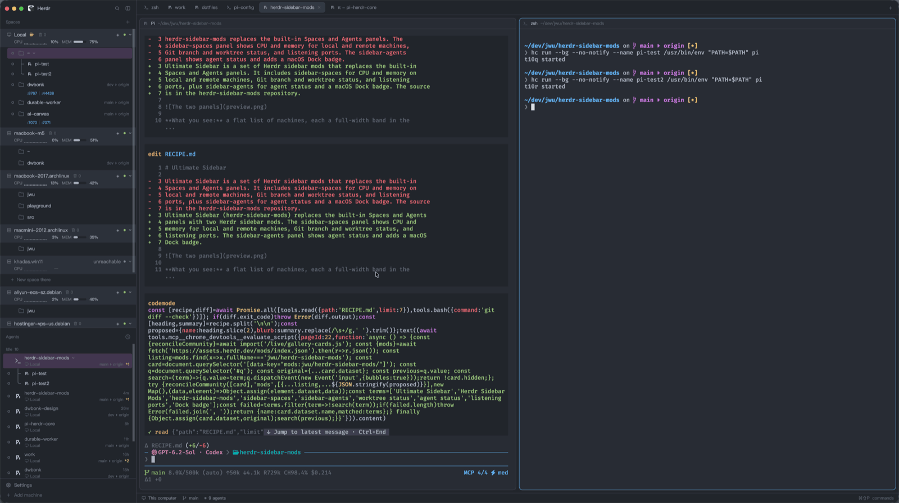

# Ultimate Sidebar

Ultimate Sidebar (herdr-sidebar-mods) replaces the built-in Spaces and Agents
panels with two Herdr sidebar mods. The sidebar-spaces panel shows CPU and
memory for local and remote machines, Git branch and worktree status, and
listening ports. The sidebar-agents panel shows agent status and adds a macOS
Dock badge.

**What you see:** a flat list of machines, each a full-width band in the
sidebar's surface color (no side margins, square corners). Inside a band's
first line, left to right: a monitor icon for this computer or a server icon
for a remote machine (muted), the machine name in 13.5px medium weight
(foreground when connected, muted when asleep), the machine's state word when
it is not connected, a `+` to start a space there, a 6px status dot (green
connected, gray otherwise), and a chevron for folding the group. Under it,
indented past the icon, a second line in 11px: `CPU`, a 16-slot sparkline of
2–3px bars (3px wide, 1px apart, 14px tall, oldest left, empty slots a 2px dot
in the border color), the CPU share right-aligned in a 28px column, then `MEM`,
a 36×6 rounded meter filled from the left, and the memory share. Shares below
75% CPU / 80% memory read in the foreground color; from those marks they turn
the theme's yellow, and from 90% its red. A stale reading (the last sample
failed) keeps its numbers gray instead.

Below a machine band sit its space rows, each 30px tall (28px for a worktree),
20px in from the left and 8px from the right (the same right air the agent rows
have), 4px corners, 1px of vertical air. The machine band itself keeps the full
width. A row
reads: a 14px state slot (a spinning ring while working, a red `!` badge when
blocked, a hollow ring when idle, a green dot when done — empty when the space
has no agent), a folder icon (branch icon for a worktree, indented another
22px), the space name (up to 150px), then flush right its git tail in 11.5px
dim type: the repository name when it differs from the space's, a branch icon
with the branch name, `▸` and the remote it tracks (`dev ▸ origin`), and green
`↑n` / red `↓n` ahead/behind counts. The selected row is the theme's magenta at
20% opacity; other rows darken on hover. The selection is one box around the
row *and* its ports line, so a selected space highlights both lines with one
4px-cornered block instead of ending above the ports.

The Agents panel repeats the pattern: a header with `Agents` and a clock
button that opens the sort menu, then sections (Pinned, then Needs you /
Done / Unread / Working / Idle by priority, or grouped per space), each heading in its
state color with a count. An agent row is two lines with 4px corners, its 14px
state slot and its 20px program icon both centred between them; a click on the
program icon folds that agent's sub-agents. The first line is the name someone
gave the agent's pane with Rename (`pane_name`, Herdr 0.1.17+; the folder moves
to the row's tooltip), else the folder the
agent's pane is in (its space when the pane has none), with the sub-agent fold
count and an age that becomes a pin button on hover flush right. The second
leads with a monitor icon for this computer or a server icon and the machine's
name (`Local` here), then flush right that place's branch `▸` remote and
`↑n`/`↓n`, plus `*n` for files changed and `✘n` for conflicts, as on a space
row. That line is budgeted the same way as a space row's: the machine
keeps six glyphs before the tail gives up its share. The git tail shares its
machine-and-folder cache with Spaces. Refs are due every 30s. Agents checks
worktree counts every 15s for the current space and the agent being viewed,
and every 60s for other spaces. Spaces can refresh counts sooner when a command ends.
Each command runs over `exec` on the agent's own machine. Sub-agent
rows are 26px, indented under tree lines. The selected agent row is the same
magenta at 20%. When the current layout has no `sidebar-spaces` block, a
gear beside the sort button opens Sidebar Settings from Agents.

Under a space row, when any of its terminals is listening, sits its ports line:
18px tall, 10.5px type in the theme's blue, indented to where the space's
name starts: each `:3000` is a listening port one of that space's own
terminals started, with a dim `|` between them, and clicking it opens `http://localhost:PORT/`. A port on another
machine copies `IP:PORT` to the clipboard instead, since there is no tunnel from
this window: the IP is that machine's ssh target host (`jwu@192.168.3.81` gives
`192.168.3.81`), and the tooltip reads `192.168.3.81:3000 · click to copy`.
Clicking the line's air between ports selects that space; a port itself only
opens (or copies), leaving the current space alone.

**How it behaves:** clicking a machine band folds or unfolds its spaces
(remembered in `localStorage` under `machines.folded`); clicking `+` starts a
space on that machine. Dragging a machine band onto another header moves that
machine there — the band you carry fades, the one under the pointer shows a 2px
accent line on the edge it will land against, and the order is remembered for
this window only under `localStorage` `machines.order`. `Local` drags like
any other and leads only until it is dragged away; a machine added later lists
after the ones you arranged, never above them. Herdr's `space.move` stays inside
a machine's block and its `space.select` counts the daemon's order, so bind
`ctrl-1..9` to `sidebar-spaces.pick1`..`pick9` in `keys.json` to have them count
the rows the panel draws instead (see the README). A row click selects the space or
focuses the agent; a
right-click on a space opens the shipped space menu. Dragging a space row up or
down shows a 2px accent line where it will land and moves it with
`space.move`; worktrees reorder inside their main checkout's group only.
On Herdr 0.1.18+, while a press is held, the list also watches the whole window (`on_window_mouse_up`,
`on_window_mouse_move`): a drag released outside the list, over a terminal or
outside the window, ends without a drop, and the drop line goes while the
pointer is outside the list. Hovering a machine band tints it. The sidebar width drives the detail: at 260px
and wider the sparkline and meter show; from 200px the graphics give way to a
single 3px vertical gauge per reading; below 200px only the numbers remain, with
the line tucked in under the icon so the shares still fit; below 160px the whole
panel falls back to the icon rail (numbers only, one letter cell per machine).
A space row shares its line between the name and its git tail by character
budget: each segment keeps one glyph, then they grow in turn until the line is
full, and the tail gives up its share before the name drops under eight glyphs.
No width step switches that, so dragging the sidebar narrows both smoothly. The
tail also carries the tree's work in the theme's yellow (`*3` files changed) and
its conflicts in red (`✘1`), and its ahead/behind counts in starship's green and
red, each a fixed segment of its own. Agents fold and unfold their sub-agents from the
program icon, sort by priority or by space from the clock menu (remembered in
the mod's shared state `agents.sort`), and pin an agent with the pin button
that appears on hover (`terminal.pin`). On macOS the Agents panel sets the Dock
badge to the number of listed agents whose actual state is blocked, done or unread,
counted before grouping or folding (not the parent's promoted urgency). It writes
only when the count changes and clears at zero and on panel close. The sort
and settings overlays leave the badge alone. Other badge-setting mods share the
same last-writer-wins API. The Agents panel passes its rows to `setAgentOrder`, so
`agent.next`, `agent.prev` and, on Herdr 0.1.18+, `agent.select {index}`
follow the order the panel shows: pinned first, sorted or grouped as shown,
with sub-agents of a plain terminal counted under it.

An idle agent row's hover adds a crossed-out eye beside the pin: it marks the
agent unread in the shared state `sidebar.unread` (address → the core's turn at
marking and whether focus has left since). The core keeps reporting a looked-at
agent as done, so a changed turn, not the status, tells a new turn apart. A
marked agent shows a dot in the unread color (red, yellow, blue or purple from
the theme's ANSI colors, `sidebar.agents.unreadColor`) and sits in its own
Unread section; the row's check and the section heading's double check clear
marks. A new turn, any state but idle or done, or the terminal ending always
clears it; with `sidebar.agents.unreadClear` at its default, leaving the agent
and coming back does too. Spaces and the pane header read the same marks. One
dot standing for many agents (a space row, a folded group or fold count)
ranks blocked > done > working > unread > idle; sections rank unread above
working.

Both `mod.json` files add command palette entries (Herdr 0.1.18+, older Herdr
ignores the key): `sidebar-spaces.settings` opens Sidebar Settings,
`sidebar-spaces.keep-awake` toggles the cup where `caffeinate` exists and shows
an info notification otherwise. `sidebar-agents.sort-priority` / `sort-grouped`
set `agents.sort`. Each panel reads them with `nextCommand()`, so they reach
only a shown copy, and the palette accepts them only while the folder names
match the mods'.

The Spaces scroll area tracks a `ScrollHandle`: selecting a different space,
changing its displayed index or resizing the list brings the active row into
view. The direct-child index includes machine bands and login guidance, but
not a space's ports line (it is inside the row's selection box). Folded rows
have no scroll target. Agents also tracks a `ScrollHandle`, counting group
headers and sub-agent rows. New focus (including peek or an agent block) unfolds
the target's group and parent, then reveals it. Unchanged focus does not undo a
manual fold or reset manual scrolling; order and viewport changes reveal again.
A remote machine that needs login offers its
`hc machine login <name>` command with Copy; the rail opens Settings > Machines
instead. A `keeps_running_after_logout: false` machine shows the shipped logout
warning and opens the official machine-add dialog for the fix (core 0.1.21+).

**Built from**

- `sidebar-spaces` uses `main.js` for the Spaces view and polling state,
  `probe.js` for the combined machine load and port script and its parsers,
  and `cup.js` for the keep-awake commands and PID file. `mod.json` declares the
  panel and palette entries. `coffee.svg`, `coffee-full.svg`, `keep.svg`,
  `trash.svg`, and `unplug.svg` supply its local icons.
- `sidebar-agents` uses `main.js` for agent rows, navigation, sorting, Git
  scheduling, and the Dock badge. `mod.json` declares the panel and its sort
  palette entries. `keep.svg` supplies the keep-as-tab icon.
- Both sidebar folders carry identical copies of `shared.js` for the Git
  cache, row helpers, and settings keys, and `settings.js` for the settings
  dialog and gear. Each panel loads its own copies.
- The optional `pane-header` uses `main.js` for pane labels, status, and
  controls, `mod.json` for the mod declaration, and `close.svg`, `send-back.svg`,
  `split-down.svg`, `split-right.svg`, `zoom.svg`, and `unzoom.svg` for controls.
- Each folder also has `jsconfig.json` and `gpui-kit.d.ts` for editor support.

The sidebars use `herdr` functions including `spaces`, `machines`, `panes`,
`agents`, `terminals`, `focused`, `theme`, `shared`, `setShared`, `layout`,
`window`, `run`, `exec`,
`hc`, `openOverlay`, `closeOverlay`, `props`, `watchFolder`, `setAgentOrder`,
`checking`, `setBadge`, `notify`, `nextCommand`. Messages (Clear results,
a copied remote port, a keep without a space) go through `notify`; herdr's
`window()` is a state snapshot with no toast method, and it is null during a
check, so read it as `window()?.…`.
From `gpui-kit`: `View`, `div`, `image`, `svg`; from `gpui-base`: `h_flex`,
`v_flex`, `ScrollHandle`. Commands called:
`space.select`, `space.new`, `space.move`, `pane.focus`, `terminal.peek`,
`terminal.pin`, `agent.focus`. Drawings use the shipped `workspace-chrome` mod's
SVGs (`monitor`, `server`, `folder`, `branch`, `git-branch`, `chevron-down`,
`chevron-right`, `plus`, `spinner`, `pin`, `pin-off`, `clock`, `layers`,
`check`, `settings`) and the shipped `menu` mod for the space context menu.
Each connected machine gets one `exec("sh", ["-c", …], {on: machine})` for load and listening
ports, at least 5s apart. It runs whichever probes are enabled in Sidebar Settings
and skips the call when both are off. For load, Linux reads `/proc/stat` and
`/proc/meminfo` (`MemAvailable`, else `MemFree`), macOS reads
`vm_stat`, `hw.memsize` and sums `ps -A -o %cpu=`, and MINGW/MSYS machines use
the Linux path. The machine list is `hc machine ls --json` every 15s. Both
panels share Git results in `shared("sidebar.git.v1")`, keyed by machine and
live folder. A peer result can satisfy a queued look if it was read after the
request. Each pool publishes its new results in one shared write, keeping any
newer answers already in the cache. Up to 64 recent results are shared for 15
minutes. Visible places keep local scan ages even if evicted. A first scan uses
two `rev-parse` calls to identify the repo even when paths contain newlines.
Each worktree scan uses `git --no-optional-locks -c core.fsmonitor=false status
--porcelain=v2 --branch` and reuses the repo identity when it is already known.
Between scans, `symbolic-ref`, upstream `rev-parse` and `rev-list` read refs
without walking the worktree. Refs are due every 30s. Dirty/conflict counts are
due every 60s, or every 15s for the Agents panel's current space and the agent
being viewed. Spaces can scan sooner after a terminal's command ends, a folder
moves, or a machine returns. Spaces checks up to six places at once and Agents
two. Each place runs at most two execs concurrently, with 20-second exec
timeouts. Local repo `watchFolder` events and live branch changes refresh refs
immediately. Temporary failures retain the previous answer and back off. Only
an explicit not-a-repository answer clears it. While Herdr 0.1.18+ reports the
window out of sight (`window()?.visible === false`: minimized, hidden, fully
covered, on another Space), machine load, ports, the machine list, Git checks
and the Agents age tick pause, and watch events wait in a set until the window
shows; back in view, the machine list is asked at once. Older Herdr has no
flag, so only an explicit `false` pauses. Leaving a place drops its local
Git cache; a local repository no longer shown has its pending watch cancelled,
and cancellation never restarts the watch. Space colors
under `space.colors` stay maintained for the space picker. The listening-port
probe runs `ss -ltnp` or falls back to
`lsof -nP -a -u "$(id -u)" -iTCP -sTCP:LISTEN -Fpcn` for the current user's
processes. Each listening pid's environment names where it was started —
`HC_TERMINAL_ID` from herdr-core, `HERDR_WORKSPACE_ID` from a Herdr pane — which `panes()` and
`spaces()` resolve to a space through the pane's tab. A listener that names
neither is dropped rather than guessed at from a process tree or a working
folder.

**Watch out:** these mods require Herdr app 0.1.16 or newer. Both initialize
render state before returning early from `init` when `checking()` is true:
no helper commands, timers, file changes, pin migration or badge writes run in
a check. Render-time shared writes and automatic space moves are also skipped.
Malformed saved JSON and unexpected panel-state types fall back to empty state;
valid machine order, folding, pins and agent timestamps are preserved.

Both mods assume the layout's sidebar node keeps `"id":
"sidebar"` — they read its width for the compact fallbacks, and without it the
width reads as infinite (always full detail). They also reach into the shipped
`workspace-chrome` mod for icons, so a renamed or removed icon path breaks
silently. The agents mod opens its own sort and settings overlays, so the
folder name (`sidebar-agents`) must match the `mod` name passed to `openOverlay`.
CPU is a delta over two samples, so a machine shows `—` for its first five
seconds; macOS CPU is `ps`'s per-process percentage
summed and divided by the core count, an approximation, and Windows memory is
`MemTotal - MemFree`, so it reads higher than Task Manager. Windows without a
POSIX shell gets `—` for both. The machine band is deliberately full-bleed and
square while the space rows are inset and rounded; the 2px row gaps and 4px
corners are intentional, not spacing accidents. The layout blocks must point at
`sidebar-spaces` and `sidebar-agents` after installing; the shipped `spaces`
and `agents` are rewritten by Herdr on every start, so never edit those in
place. A port line needs either `ss` or `lsof` on that machine (both read only
that user's own sockets), and it shows nothing for a server started outside
Herdr's terminals, so `docker run -p`, a systemd unit, or a server from your
login shell stays invisible by design. A remote port cannot be opened from
here — `hc` has no port forwarding — so a click copies the address instead. The
line sits under the space and indents past its icons, so a space with servers
is 18px taller than one without.

**Done when:** `node --test tests/*.test.mjs` passes, and
`herdr-app check mods/sidebar-spaces` and `herdr-app check
mods/sidebar-agents` both pass; a screenshot of the window shows a machine band
with two lines (name, then `CPU ▁▂▃ 12%  MEM ━━─ 61%`), a space row with a
state icon, folder, name and a purple `dev ▸ origin` tail, and an agent row
whose state icon precedes the program icon; CPU and memory numbers appear
within ten seconds and their bars move with load; clicking a machine band folds
its rows; dragging a machine band onto another header reorders the machines and
survives a reload; `herdr-app do sidebar-spaces.pick5` shows the fifth row the
panel draws, and ctrl-5 does the same once `keys.json` binds it; `+` starts a space; dragging a space row shows the accent line and
moves it; narrowing the sidebar below 260px swaps the sparkline and meter for
gauges, and below 200px leaves numbers only; a server started in a space's
terminal (`python3 -m http.server 8000`) lists `:8000` under that space within
five seconds, clicking it opens it in the browser, and ending the server takes
the number away. Switching to a space outside the visible scroll area reveals
it in the custom machine order, and resizing keeps it visible. A blocked or done
agent contributes one to the macOS Dock badge; clearing those states clears the
badge. Checks emit no helper-command warnings and do not touch the caffeine PID.
Agent navigation reveals a row outside the viewport and unfolds its parent/group
only on new focus. Dragging a Space inside its machine block still reorders it,
while an ordinary click keeps its old action. On Herdr 0.1.18+, minimizing the
window stops the panel's `exec` and `hc` calls until it shows again, letting a
drag go over a terminal leaves no drop line behind, `herdr-app do
agent.select:2` focuses the second agent the panel lists, and the command
palette lists Sidebar settings and the agent sort entries.
