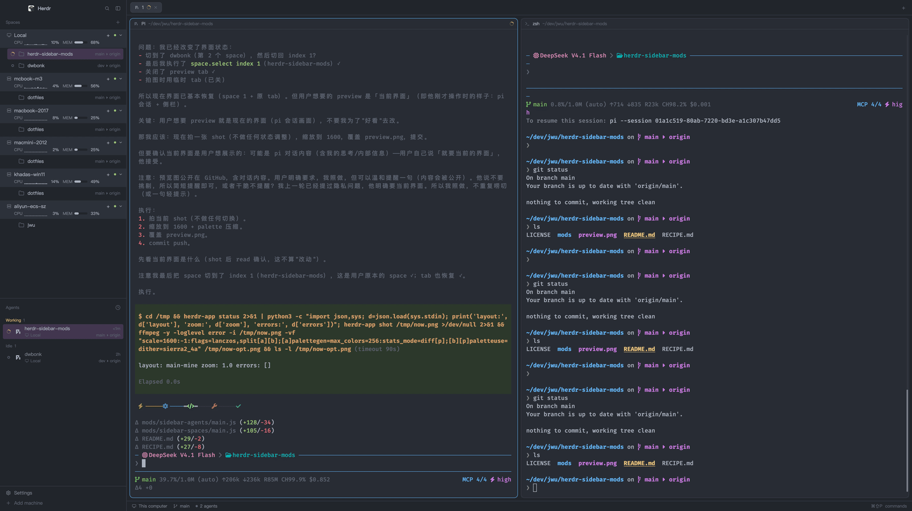

# Sidebar: machines with load, spaces with git, agents with state

A replacement for the left sidebar's Spaces and Agents panels in the Herdr
desktop app. Every machine header carries a second line with its CPU sparkline
and memory meter; every space row carries its branch and tracked remote; every
space and agent row leads with its state icon, and a row you select turns a
quiet purple instead of gray.

**What you see:** a flat list of machines, each a full-width band in the
sidebar's surface color (no side margins, square corners). Inside a band's
first line, left to right: a monitor icon for this computer or a server icon
for a remote machine (muted), the machine name in 13.5px medium weight
(foreground when connected, muted when asleep), the machine's state word when
it is not connected, a `+` to start a space there, a 6px status dot (green
connected, gray otherwise), and a chevron for folding the group. Under it,
indented past the icon, a second line in 11px: `CPU`, a 16-slot sparkline of
2–3px bars (3px wide, 1px apart, 14px tall, oldest left, empty slots a 2px dot
in the border color), the CPU share right-aligned in a 28px column, then `MEM`,
a 36×6 rounded meter filled from the left, and the memory share. Shares below
75% CPU / 80% memory read in the foreground color; from those marks they turn
the theme's yellow, and from 90% its red. A stale reading (the last sample
failed) keeps its numbers gray instead.

Below a machine band sit its space rows, each 30px tall (28px for a worktree),
20px in from the left and 8px from the right (the same right air the agent rows
have), 4px corners, 1px of vertical air. The machine band itself keeps the full
width. A row
reads: a 14px state slot (a spinning ring while working, a red `!` badge when
blocked, a hollow ring when idle, a green dot when done — empty when the space
has no agent), a folder icon (branch icon for a worktree, indented another
22px), the space name (up to 150px), then flush right its git tail in 11.5px
dim type: the repository name when it differs from the space's, a branch icon
with the branch name, `▸` and the remote it tracks (`dev ▸ origin`), and green
`↑n` / red `↓n` ahead/behind counts. The selected row is the theme's magenta at
20% opacity; other rows darken on hover.

The Agents panel repeats the pattern: a header with `Agents` and a clock
button that opens the sort menu, then sections (Pinned, then Needs you /
Working / Done / Idle by priority, or grouped per space), each heading in its
state color with a count. An agent row is two lines with 4px corners, its 14px
state slot and its 20px program icon both centred between them; a click on the
program icon folds that agent's sub-agents. The first line is the folder the
agent's pane is in (its space when the pane has none), with the sub-agent fold
count and an age that becomes a pin button on hover flush right. The second
leads with a monitor icon for this computer or a server icon and the machine's
name (`Local` here), then flush right that place's branch `▸` remote and
`↑n`/`↓n`. That line is budgeted the same way as a space row's: the machine
keeps six glyphs before the tail gives up its share. The git tail is read with
`git status --porcelain=v2 --branch` at most every 30s per folder, over `exec`
on the agent's own machine. Sub-agent
rows are 26px, indented under tree lines. The selected agent row is the same
magenta at 20%.

**How it behaves:** clicking a machine band folds or unfolds its spaces
(remembered in `localStorage` under `machines.folded`); clicking `+` starts a
space on that machine. Dragging a machine band onto another header moves that
machine there — the band you carry fades, the one under the pointer shows a 2px
accent line on the edge it will land against, and the order is remembered for
this window only under `localStorage` `machines.order`. `Local` drags like
any other and leads only until it is dragged away; a machine added later lists
after the ones you arranged, never above them. Herdr's `space.move` stays inside
a machine's block and its `space.select` counts the daemon's order, so bind
`ctrl-1..9` to `sidebar-spaces.pick1`..`pick9` in `keys.json` to have them count
the rows the panel draws instead (see the README). A row click selects the space or
focuses the agent; a
right-click on a space opens the shipped space menu. Dragging a space row up or
down shows a 2px accent line where it will land and moves it with
`space.move`; worktrees reorder inside their main checkout's group only.
Hovering a machine band tints it. The sidebar width drives the detail: at 260px
and wider the sparkline and meter show; from 200px the graphics give way to a
single 3px vertical gauge per reading; below 200px only the numbers remain, with
the line tucked in under the icon so the shares still fit; below 160px the whole
panel falls back to the icon rail (numbers only, one letter cell per machine).
A space row shares its line between the name and its git tail by character
budget: each segment keeps one glyph, then they grow in turn until the line is
full, and the tail gives up its share before the name drops under eight glyphs.
No width step switches that, so dragging the sidebar narrows both smoothly. Agents fold and unfold their sub-agents from the
program icon, sort by priority or by space from the clock menu (remembered in
the mod's shared state `agents.sort`), and pin an agent with the pin button
that appears on hover (`terminal.pin`).

**Built from:** two mods, `sidebar-spaces` and `sidebar-agents`, each with a
`main.js` and a `mod.json` (`{"place":"none","title":"Spaces"|"Agents"}`). Both
import from `herdr`: `spaces`, `machines`, `panes`, `agents`, `terminals`,
`focused`, `theme`, `shared`, `setShared`, `layout`, `window`, `run`, `exec`,
`hc`, `openOverlay`, `closeOverlay`, `props`, `watchFolder`, `setAgentOrder`.
From `gpui-kit`: `View`, `div`, `svg`, `h_flex`, `v_flex`. Commands called:
`space.select`, `space.new`, `space.move`, `pane.focus`, `terminal.peek`,
`terminal.pin`, `agent.focus`. Drawings use the shipped `workspace-chrome` mod's
SVGs (`monitor`, `server`, `folder`, `branch`, `git-branch`, `chevron-down`,
`chevron-right`, `plus`, `spinner`, `pin`, `pin-off`, `clock`, `layers`,
`check`) and the shipped `menu` mod for the space context menu. Machine load is
sampled every 5s with `exec("sh", ["-c", …], {on: machine})`: Linux reads
`/proc/stat` and `/proc/meminfo` (`MemAvailable`, else `MemFree`), macOS reads
`vm_stat`, `hw.memsize` and sums `ps -A -o %cpu=`, and MINGW/MSYS machines use
the Linux path. The machine list is `hc machine ls --json` every 15s; git is
`git --no-optional-locks status --porcelain=v2 --branch` plus `rev-parse` per
space folder, refreshed when a terminal's command ends, a space moves, or a
machine comes back, with local repos watched via `watchFolder`. Space colors
under `space.colors` stay maintained for the space picker.

**Watch out:** both mods assume the layout's sidebar node keeps `"id":
"sidebar"` — they read its width for the compact fallbacks, and without it the
width reads as infinite (always full detail). They also reach into the shipped
`workspace-chrome` mod for icons, so a renamed or removed icon path breaks
silently. The agents mod opens its own sort overlay, so the folder name
(`sidebar-agents`) must match the `mod` name passed to `openOverlay`, or the
clock button does nothing. CPU is a delta over two samples, so a machine shows
`—` for its first five seconds; macOS CPU is `ps`'s per-process percentage
summed and divided by the core count, an approximation, and Windows memory is
`MemTotal - MemFree`, so it reads higher than Task Manager. Windows without a
POSIX shell gets `—` for both. The machine band is deliberately full-bleed and
square while the space rows are inset and rounded; the 2px row gaps and 4px
corners are intentional, not spacing accidents. The layout blocks must point at
`sidebar-spaces` and `sidebar-agents` after installing; the shipped `spaces`
and `agents` are rewritten by Herdr on every start, so never edit those in
place.

**Done when:** `herdr-app check mods/sidebar-spaces` and `herdr-app check
mods/sidebar-agents` both pass; a screenshot of the window shows a machine band
with two lines (name, then `CPU ▁▂▃ 12%  MEM ━━─ 61%`), a space row with a
state icon, folder, name and a purple `dev ▸ origin` tail, and an agent row
whose state icon precedes the program icon; CPU and memory numbers appear
within ten seconds and their bars move with load; clicking a machine band folds
its rows; dragging a machine band onto another header reorders the machines and
survives a reload; `herdr-app do sidebar-spaces.pick5` shows the fifth row the
panel draws, and ctrl-5 does the same once `keys.json` binds it; `+` starts a space; dragging a space row shows the accent line and
moves it; narrowing the sidebar below 260px swaps the sparkline and meter for
gauges, and below 200px leaves numbers only.
